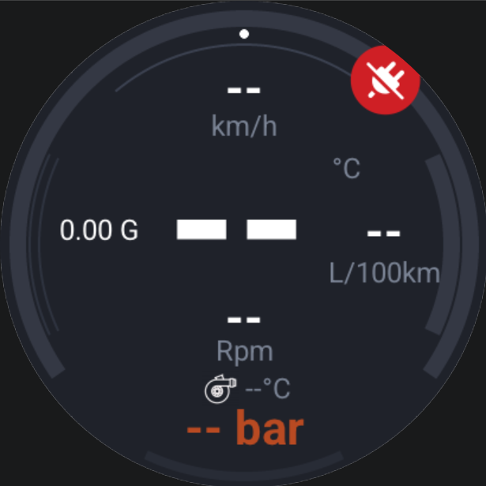

# Car HUD

A modern, high-performance automotive Head-Up Display (HUD) and digital instrument cluster running on ESP32-S3 round displays. Communicates with the vehicle ECU over Bluetooth Low Energy (BLE) via an ELM327 OBD-II adapter using ISO 15765-4 (CAN 11-bit 500k) protocol and renders telemetry with **LVGL 9**.



---

## ✨ Features

- **Automotive Startup Gauge Sweep**: 1.4-second ignition ceremony sweeping the tachometer, boost, and fuel consumption arcs up to maximum and back down to zero with smooth S-curve cosine easing.
- **Disconnected Fallback (`"--"`)**: Readouts show clean `"--"` default values when the ignition is off or OBD-II is disconnected, with error overlay icons for link and CAN bus status.
- **Center Hero Coolant Temperature**: High-visibility center readout for engine coolant temperature (`°C`).
- **Tachometer & Speedometer**:
  - Main tachometer arc (0–5000 RPM) with digital RPM readout.
  - Top digital vehicle speed (`km/h`).
- **Turbo Boost Gauge**: Real-time boost pressure (`bar`) with bottom accent arc (0–2.50 bar), featuring auto-calibration of ambient atmospheric pressure at idle.
- **Instant Fuel Consumption**:
  - Dynamic switching: Displays **L/100km** while driving and **L/h** when stopped / idling.
  - Right-side active gauge arc (0–35 L/100km).
  - Compatible with direct OBD-II PID `015E` and CRDi diesel fuel-rate calculation (Engine Load PID `0104` + RPM PID `010C` tailored for 1.5 CRDi / Bosch EDC16 ECUs).
- **Intake Air Temperature (IAT)**: Real-time manifold intake charge temperature (`°C`).
- **Real-Time G-Force Meter**: Dynamic lateral and longitudinal acceleration meter using the onboard **QMI8658 6-axis IMU**, with gravity-vector baseline subtraction and auto-zeroing at standstill.
- **OBD-II DTC Diagnostics & Clearing**:
  - Dedicated Diagnostic Trouble Code screen accessible from Settings.
  - Automatically queries ECU Mode 03 and displays decoded fault codes with short descriptive titles.
  - One-touch DTC clearing (OBD Mode 04) with engine safety interlock (Clear button is enabled only when engine is off, locked when engine is running).
- **Settings Screen**:
  - Adjustable backlight brightness.
  - HUD mirror / flip mode for windshield reflection projection.
  - Deep sleep restart and disconnect auto-reboot.
  - Direct shortcut to DTC Diagnostics screen.

---

## 🏎️ Telemetry & Parameters

| Metric | Display Range | Sensor / PID Source | Description |
| :--- | :--- | :--- | :--- |
| **Speed** | 0 – 255 km/h | Mode 01 PID `010D` | Digital vehicle road speed |
| **Coolant Temp** | -40 – 215 °C | Mode 01 PID `0105` | Center hero temperature display |
| **Engine RPM** | 0 – 5000 RPM | Mode 01 PID `010C` | Perimeter tachometer arc & digital readout |
| **Turbo Boost** | 0.00 – 2.50 bar | Mode 01 PID `010B` (MAP) | Relative boost pressure over ambient atmospheric |
| **Fuel Consumption** | 0.0 – 35.0 L/100km | PID `015E` / PID `0104` + `010C` | Instant fuel consumption arc & digital readout |
| **Intake Temp** | -40 – 215 °C | Mode 01 PID `010F` (IAT) | Charge air temperature |
| **G-Force** | 0.00 – 2.50 G | Onboard QMI8658 6-axis IMU | Planar acceleration magnitude |
| **DTC Fault Codes** | Confirmed DTCs | Mode 03 / Mode 04 | Read decoded DTCs & Clear with engine off |

---

## 🛠️ Supported Hardware

### 1. Displays & Boards
- **Waveshare ESP32-S3-Touch-LCD-1.46** *(Primary target)*:
  - 1.46-inch 412x412 circular IPS display (QSPI SPD2010 controller).
  - Onboard QMI8658 6-axis IMU (I2C address `0x6B`).
  - TCA9554 IO Expander with capacitive touch screen.
- **Viewe SmartRing 1.8" AMOLED** (ESP32-S3 round display).
- **Elecrow 3.5" TFT** (ESP32 / ESP32-S3).
- **WT32-SC01**.

### 2. OBD-II Adapter
- Any standard **BLE OBD-II ELM327 Mini** adapter (UUID `FFF0` / `FFF1` vendor service).

---

## 🚗 Vehicle Compatibility

- **Protocol**: ISO 15765-4 (CAN 11-bit ID, 500 kbaud).
- **Pre-configured Profile**: **Hyundai Accent MC (2005–2011) 1.5 CRDi Diesel** (Engine: D4FA, Bosch EDC16C39 ECU).
- Fully compatible with any standard passenger vehicle supporting OBD-II CAN (Mode 01 PIDs).

---

## 💻 Build & Flash

Built using [PlatformIO](https://platformio.org/).

### Build for Waveshare 1.46" Circular LCD:
```bash
pio run -e waveshare_s3_1_46
```

### Upload to Device:
```bash
pio run -e waveshare_s3_1_46 -t upload
```

### Monitor Serial Logs:
```bash
pio device monitor -b 115200
```

---

## 📄 License

MIT License. See [LICENSE](LICENSE) for details.
